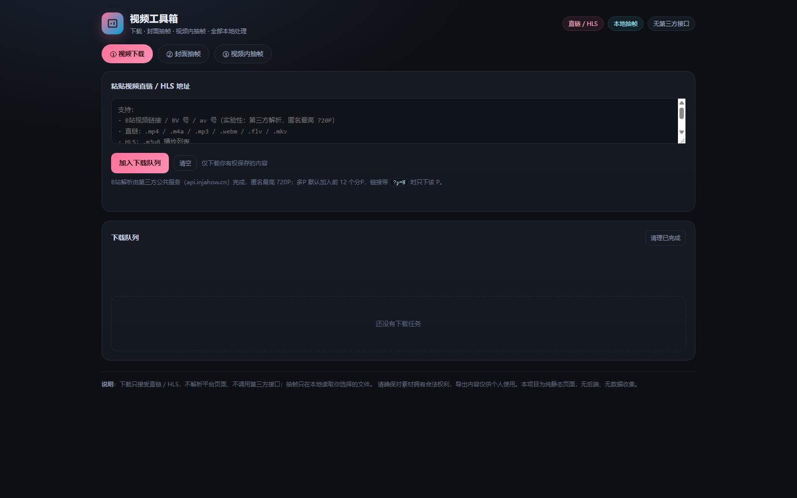

# 视频工具箱 · Video Toolkit

一个纯静态、零后端的视频小工具集合，包含三件事：

| 功能 | 说明 |
|---|---|
| **视频下载** | 支持 B站视频链接 / BV 号 / av 号（第三方解析，匿名最高 720P）；直链（mp4 / m4a / mp3 / webm / flv / mkv）；HLS（`.m3u8` 分片合并）。带队列、进度、速度、取消 |
| **封面抽帧** | 选择本地视频，截取当前画面导出 PNG，适合做封面 / 缩略图 |
| **视频内抽帧** | 精确跳到某一秒（可输入秒数），支持上一帧 / 下一帧（30fps 步进）、0/25/50/75/末帧预设，导出 PNG |

所有处理都在浏览器本地完成：**无后端、无上传、无数据收集**。网络行为只有两类：下载时请求直链 / HLS / 视频 CDN；解析 B站链接时请求第三方公共解析服务。

## 直接使用

**在线地址：<https://yuxuanhrbeu-sketch.github.io/video-toolkit/>**

GitHub Pages 托管，打开即用，无需安装、无需构建。



也可以下载本仓库，双击 `index.html` 在本地打开（功能一致）。

> 注意：GitHub 的仓库页面本身不会执行 HTML；「直接使用」指的是 GitHub Pages 提供的静态站点地址。

## 使用限制（务必阅读）

- **B站链接**：通过第三方公共服务 `api.injahow.cn/bparse` 解析，匿名最高 **720P**；不支持 1080P+ / 4K / 充电专属 / 大会员内容，也不绕过登录或付费。多P 默认加入前 12 个分P，链接带 `?p=N` 时只下该 P。`b23.tv` 短链请先在浏览器打开、复制完整链接。
- **直链 / HLS**：不解析平台页面。下载受目标站点 **CORS** 限制：对方不允许跨域时，浏览器无法读取内容，会报错。能不能下取决于源站。
- **YouTube / 抖音等**：暂不支持（需要专门的解析能力，且可能违反平台条款）。
- HLS 合并输出为 `.ts`（分片为 fMP4 时输出 `.mp4`），播放器选 VLC / PotPlayer 即可。
- 抽帧只读取你**本地选择**的视频文件，文件不会上传；导出 PNG 长边上限 4096px。
- 请仅用于你**拥有合法权利**或已获授权的内容；版权责任由使用者自行承担。B站解析由第三方提供，其可用性与合规性请自行判断。

## 本地运行

```bash
# 任选一种
python -m http.server 8080
# 然后打开 http://127.0.0.1:8080
```

或直接双击 `index.html`。

## 部署到 GitHub Pages

1. 把本仓库推到 GitHub（public）。
2. 仓库 **Settings → Pages**：
   - Source: **Deploy from a branch**
   - Branch: `main`，目录选 **/(root)**
3. 保存后等待 1–2 分钟，访问 `https://<用户名>.github.io/<仓库名>/`。

本项目是单文件 `index.html`，无需构建、无依赖。

## 技术说明

- 纯原生 HTML / CSS / JavaScript，无框架、无 CDN。
- 下载：`fetch` + `ReadableStream` 读取，`Blob` 保存；HLS 解析 `#EXT-X-STREAM-INF` / `#EXT-X-MAP` 后按分片顺序合并。
- 抽帧：`video.currentTime` 定位 → 等 `seeked` → `requestVideoFrameCallback` → `canvas.drawImage` → `toBlob('image/png')`。
- 帧步进按 30fps 估算（1/30s），不同帧率视频会有细微差异。

## 免责声明

本项目仅供个人学习与离线使用。请尊重创作者版权，不要二次传播或商用。使用本工具产生的任何版权、合规责任由使用者自行承担；如权利人投诉，请立即停止使用并删除相关内容。

## License

[MIT](LICENSE)
